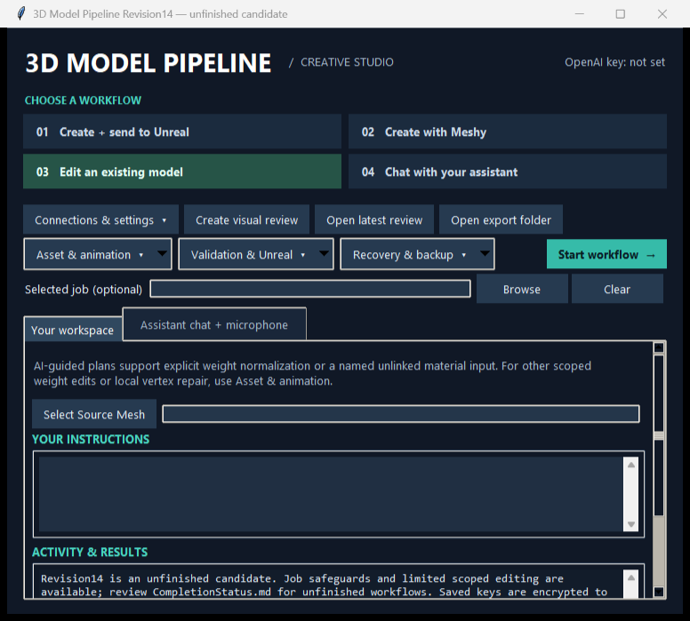

# 3D Model Pipeline

I built this Windows tool with Codex to make Blender-to-Unreal asset work easier to review. When I already have a good model, I want to see exactly what a proposed edit changed before it reaches the game. The pipeline preserves the original asset, saves edits to a separate candidate, and records checks alongside the result.

## What I built

1. **Inspect the source.** Blender inventories geometry, UVs, materials, skin weights, bones, and animation data. The job records a source hash and compares the original with its working copy.
2. **Prepare a candidate.** Scoped material, weight, or motion changes write to a versioned file. The existing mesh and rig can stay in place throughout the job.
3. **Verify the round trip.** The tool reopens the result and compares the properties the job is meant to preserve. Selected skeletal workflows also import into an isolated Unreal project for review.
4. **Review the result.** Technical checks and side-by-side renders give me two ways to judge a candidate before I adopt it. Visual approval stays with the person reviewing the asset.

## A bug I tracked down

Two skeletal FBX trials lost duplicate faces during export and failed the triangle-count check. I used separate export candidates that preserved the checked face-corner positions, UVs, material assignments, and named skin weights across three levels of detail. Sampled poses were checked after reimporting into Blender and Unreal. The technical pass covered those samples, and continuous motion and deformation still called for visual review.

The same workflow can support an animated slot character or bonus-scene prop. I can check the mesh, rig, and clip in isolation, then review the rendered animation at the size players will actually see. The current desktop build is a development tool. Broader rig coverage and paid generation flows are still in review.
